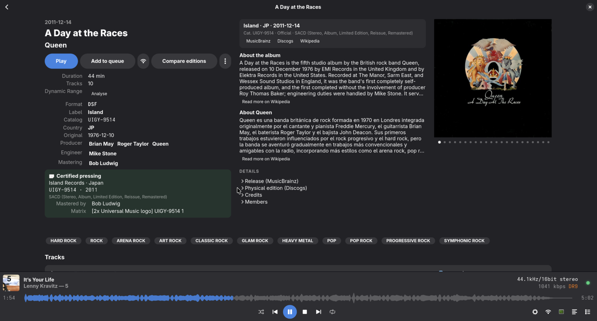
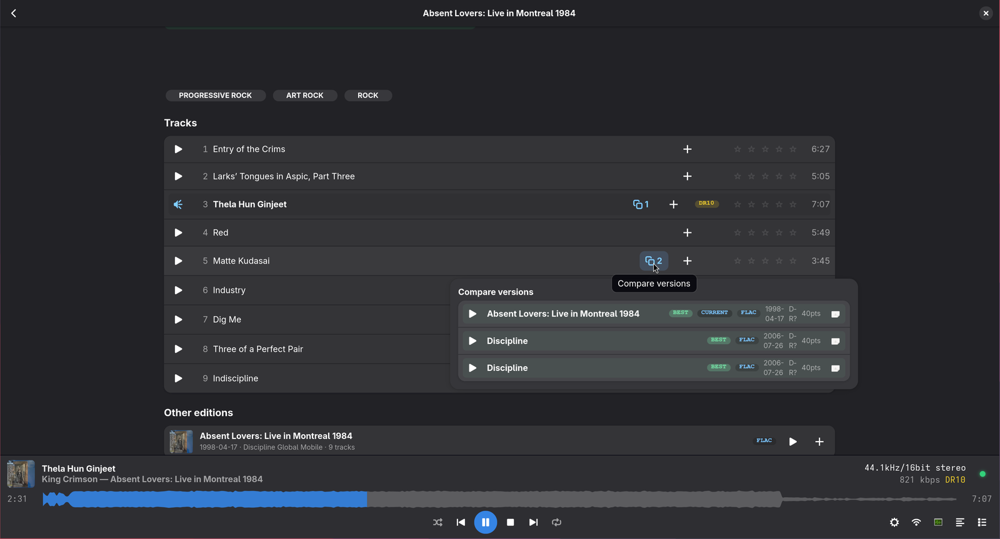
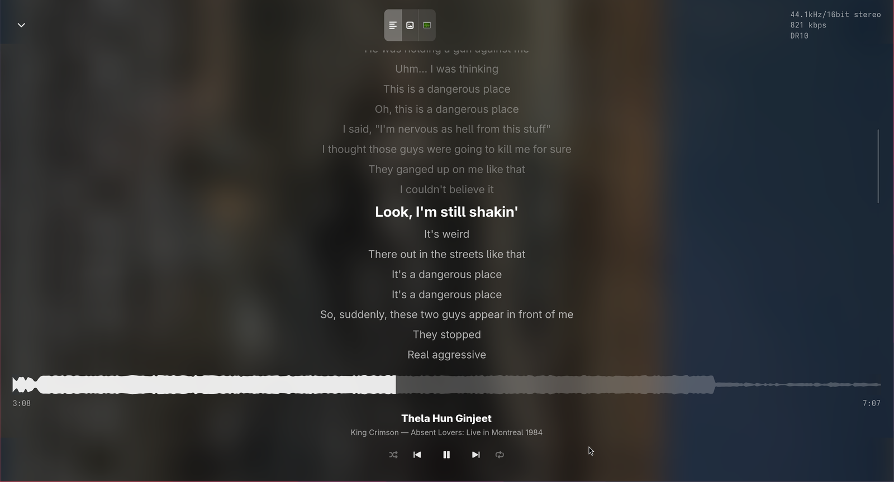
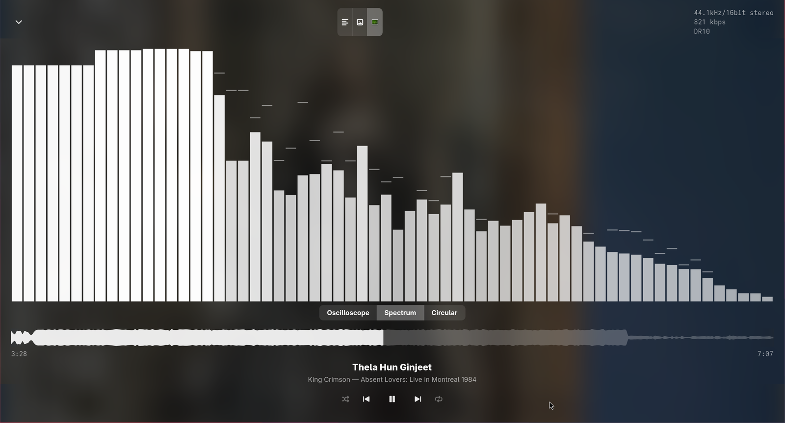
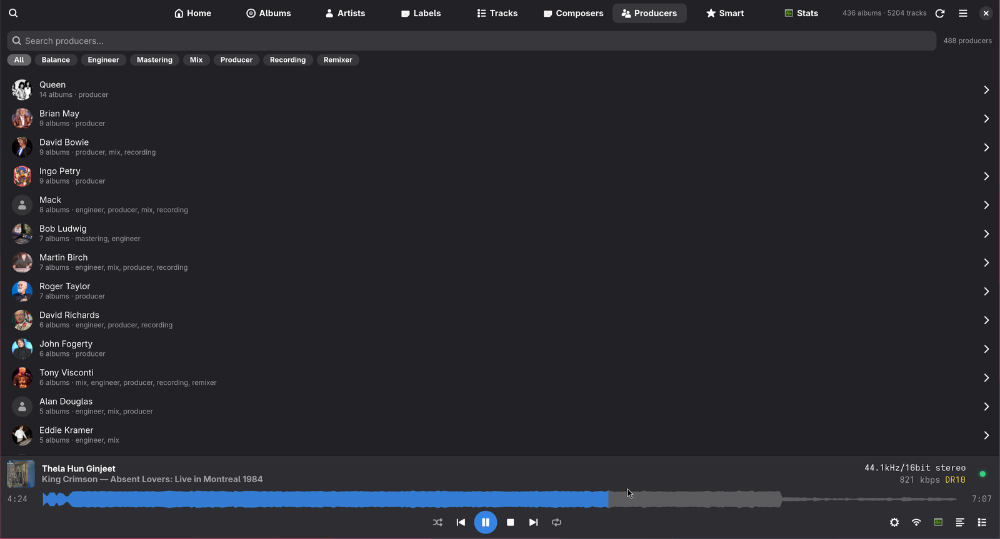
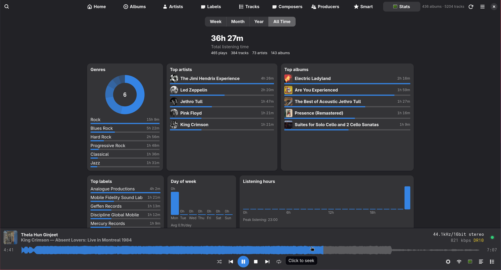

<p align="center">
  
</p>

<h1 align="center">ObiPlayer</h1>

<p align="center">
  A music player for <a href="https://www.musicpd.org/">MPD</a> — local or remote — for people who care about
  editions, pressings and sound quality.<br>
  GTK4 · libadwaita · Rust · Linux
</p>

<!-- VIDEO -->

<p align="center">
  
  <br><em>The exact pressing: credits, catalogue number and country cross-checked with MusicBrainz and Discogs, DR14, certified pressing card</em>
</p>

<table>
  <tr>
    <td width="50%"><br><em>Every version of a track across your editions, ranked</em></td>
    <td width="50%"><br><em>Now playing with synced lyrics</em></td>
  </tr>
  <tr>
    <td><br><em>Spectrum, oscilloscope and circular visualizers</em></td>
    <td><br><em>Producers, engineers and mastering credits across the library</em></td>
  </tr>
  <tr>
    <td colspan="2"><br><em>Listening statistics</em></td>
  </tr>
</table>

## Features

**Library**
- Album grid with covers (local folder, MPD `albumart`, Discogs / Cover Art Archive), artists, labels,
  composers, producers and a sortable tracks table; search (<kbd>Ctrl</kbd>+<kbd>F</kbd>)
- Every edition of a record side by side, every version of a track ranked by a quality score
  (DR + format), preferred versions and ratings stored as MPD stickers

**The exact pressing**
- MusicBrainz and Discogs data cross-checked against your files' label and catalogue number, so you
  never see credits from a different pressing; Wikipedia and Last.fm for context
- Producers, engineers, mastering, matrix/runout, pressing plant; certified pressing sidecars

**Sound**
- DR14 dynamic range, waveform seek bar, oscilloscope / spectrum / circular visualizers
- Bit-perfect signal path indicator (mixer, replay gain, forced formats, native DSD vs DoP)
- Loudness War DB comparison, ALSA `hw:` output setup for MPD

**Listening**
- Synced lyrics (LRCLIB), radio built from your library, smart playlists, listening stats, home shelves
- Full-window now playing view, MPRIS media keys and desktop integration
- English and Spanish

## Install

**Arch Linux**
```sh
git clone https://github.com/prietus/obiplayer && cd obiplayer/packaging/arch && makepkg -si
```

**From source** — Rust (stable), GTK ≥ 4.12, libadwaita ≥ 1.5, ffmpeg:
```sh
cargo run --release -p obiplayer
```

**Flatpak** — manifest in `packaging/flatpak/` (generate `cargo-sources.json` with
[flatpak-cargo-generator](https://github.com/flatpak/flatpak-builder-tools/tree/master/cargo) first).

## Setup

The first run opens an assistant: where MPD runs, missing programs, connection, and — for a local
server — a bit-perfect `mpd.conf` for your sound card.

With a **remote** server, mount its music folder (NFS/SMB) on this computer and set it in
*Preferences › Music folder* (*Detect* finds it among your mounts). That enables local covers,
artwork galleries, DR analysis, waveforms and visualizers; everything else works over the network.

| | Location |
|---|---|
| Configuration (MPD, music folder, API keys) | `~/.config/obiplayer/config.toml` — `MPD_HOST` / `MPD_PORT` override it |
| Caches (covers, DR, waveforms, metadata) | `~/.cache/obiplayer` |
| Play history, smart playlists | `~/.local/share/obiplayer` |

Last.fm and Discogs keys are optional (*Preferences › External APIs*).

## Contributing translations

UI strings are English in the code. `python3 scripts/extract_strings.py` refreshes
`po/obiplayer.pot`; add or update `po/<lang>.po` (embedded at build time).

## License

[GPL-3.0-or-later](LICENSE). Linux sibling of DrPlayer for macOS.
